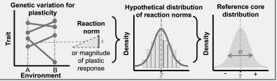
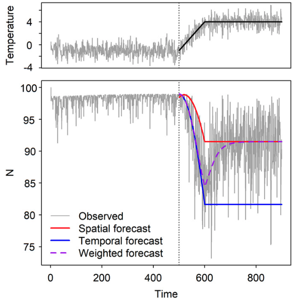

# Learning objectives

1. Understand the differences between GxE, phenotypic plasticity, local adaptation, and evolutionary rescue
2. Know how we detect each of these processes

*last lecture: previously, we've assumed all individuals of a species are basically equal, all react to environment or species interactions in same way*

*eco-evo dynamics: addresses population dynamics when there's genetic variation within populations; composed of individuals of different genotypes, not all genetically the same*

# Genotype x environment interactions

## Phenotypic plasticity vs. GxE

* Phenotypic plasticity - traits shift with environment within a genotype
* GxE - trait or fitness shifts with environment depend on genotype *different genotypes have different responses*

*Plot soil moisture x biomass with different lines for different genotypes, ask if plasitcity or GxE with each one*

*plot1: No slope - no phenotypic plasticity, no GxE (what we assumed prior to this)*

* reaction norm - plant response to a range of environmental conditions

*plot2: Parallel lines with different intercepts - plasticity with G and E but not GxE*

*non-zero slopes mean biomass is shifting with enviornment (plasticity)*

*different intercepts mean genotypes differ in biomass, but shift with environment is same, no GxE*

*plot3: Slopes differ but don’t cross - plasticity with GxE*

*plot4: Slopes differ and cross - plasticity with GxE*

## Methods

* Common gardens - genotypes planted in same environment

*draw multiple example plots with 4 genotypes planted in grid*

* Reaction norms across space - measure trait response, create distribution, use as reference distribution vs. range edges

# Local adaptation

*main difference between this and the others is this has to do with fitness, not trait shifts, and comparison of fitness in source environment vs. other environments*

* "adaptive" = affects fitness *but terminology is contentious, local adaptation has narrow definition*
  + can't confirm local adaptation from 1 life stage
* local adaptation - fitness highest in source environment; adapted to local conditions

*Plot environment A & B by fitness*

*Plot1: Local adaptation - a line high in cold, low in warm; b line high in warm low in cold*

*plot2: GxE and local adaptation - a line higher than B line, decreasing between cold and warm, a more adapted*

*question: what would maladptation or the opposite of local adaptation look like?*

*plot3: Maladaptation - opposite of local adaptation*

## Methods

* Reciprocal transplant - measure fitness in source vs. other environment for each species *this is what I drew above*
* Common garden - can be range of environments *change plot 1 x axis to continuous temperature axis*
  + multiple common gardens, each containing genotypes from other environments
  
# Evolutionary rescue

* evolutionary rescue: when populations persist under climate stress *(or other stresses)* due to rapid evolution
  + rapid evolution (rapid adaptation): genotype frequencies within a population change
  + mechanisms: genetic variation & dispersal *less commonly: mutations*
  + examples: crops evolving resistance to pesticides, antibiotic resistant bacteria

