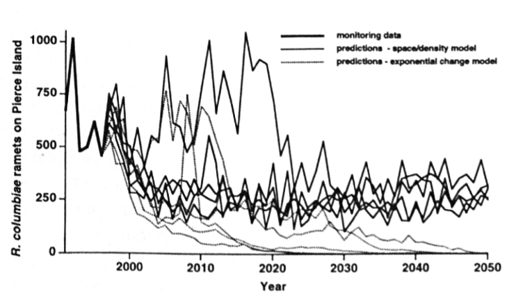

# Learning objectives

1. Understand the causes and consequences of small or rare populations
2. Know the key terms and process of population viability analysis

# What causes populations to be small or rare?

* natural causes: 
  + endemism/habitat specialization; Maguire's primrose in Logan Canyon *limestone cliffs at certain aspects and elevations*
  + dioecious (separate male and female plants); ginkgo trees
  + mutualist specialization; fig wasps
  + dispersal limitation
* anthropogenic causes:
  + habitat fragmentation
  + overexploitation; ornamental plants
  + invasive species
  + climate change
  
# Population dynamics in rare populations

## Demographic stochasticity

* variation due to chance events affecting individuals
* increases extinction risk in small populations, ignore in large populations
* reproductive individuals randomly have few offspring for a few years -> extinction risk

*plot two lines, large and small population with fluctuating populations, small pop goes to zero*

* extinction risk increases when combined with environmental stochasticity *in models*
* bad year -> lower population size -> demographic stochasticity extinction risk

## Inbreeding depression

* reduction in fitness when closely related individuals reproduce
* levels of relatedness:
  + self-fertilization
  + outcrossing within a small population
  + outcrossing between small populations
* small populations -> low genetic diversity -> more harmful alleles
* examples:
  + stunted growth
  + smaller inflorescences
  + fewer seeds

# Modeling

## Population viability analysis

* terms
  + persistence time: probability of persistence for given period of time
  + extinction probability: proportion of simulations that end in extinction
  + time to extinction: median or mean number of years to extinction
* population model + simulations projecting past trends forward
  + multiple population models
  + density dependence, env. heterogeneity, etc.
  + simulations: include stochasticity
  + can add management scenarios

# Managing rare populations

* depends on the cause of population decline
  + example: habitat protection for fragmentation
* assisted migration: moving plants to areas with suitable climate
  + survive climate change *can't otherwise disperse to sutiable habitat*
  + risks: aggressive genotypes, outbreeding depression (reduced fitness when too genetically distant)
  + example: whitebark pine *threatened by pathogens, pests, and climate change; transplants in northern edge in Canada*
