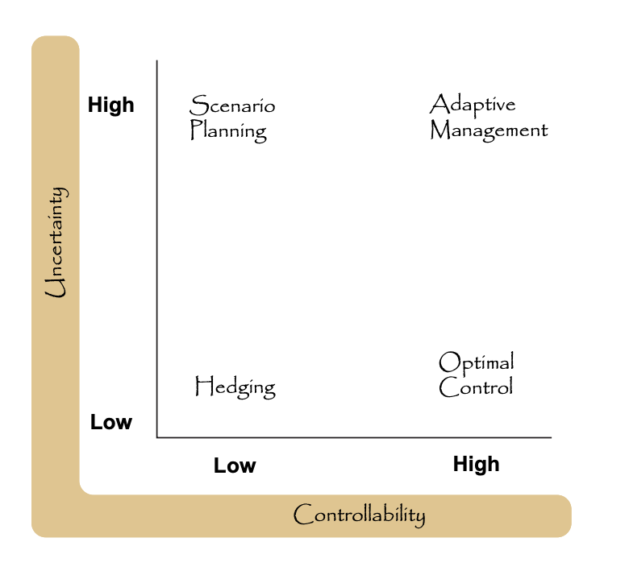

# Learning objectives

1. Identify when adaptive management is and isn't useful
2. Know the adaptive management cycle
3. Apply the adaptive management cycle to an endangered species

# Adaptive management cycle

- adaptive management: approach for resource management by learning from management outcomes
- exploring alternative management outcomes is key, incorporates contrasting stakeholder views
- particularly useful when uncertain about appropriate management strategy
- must have commitment to long-term assessment (not good for short or standalone decision making)

Assess and define objectives -> develop hypotheses and models -> implement management actions -> monitor population response -> evaluate and update

## Assess and define objectives

- what outcomes?
- must have stakeholder support
- use pre-existing methods/processes
- SMART goals
  
## Develop hypotheses and models

- what processes determine outcomes?
- competing hypotheses, suite of models
- consider life history, environmental variation, species interactions

## Implement management actions

- what interventions?
- passive vs. active, often combination
  + passive: maintain status, no intervention just monitoring *tracking population sizes of plants without altering environment*
  + active: intervention and impact on system *herbivore exclosure, invasive species removal, etc*
- experiments
  + control vs. treatment
  + before-after-control-impact
  
## Monitor population response

- what happened after management?
- comparison of predicted vs. observed responses
- assessment
  + PVA
  + costs
  
## Evaluate and update

- what should change?
- consider
  + management objectives
  + stakeholder interests
  + cost-effectiveness
  
# Challenges

*question: why might adaptive management be hard to do?*

- institutional barriers (money, competing interests, legal issues)
- long-term commitment

# Example: reintroduction of endangered salt marsh plant

| Step | example |
|---|---|
| Assess and define objectives |  |
| Develop hypotheses and models |  |
| Implement management actions |  |
| Monitor population response |  |
| Evaluate and update |  |

